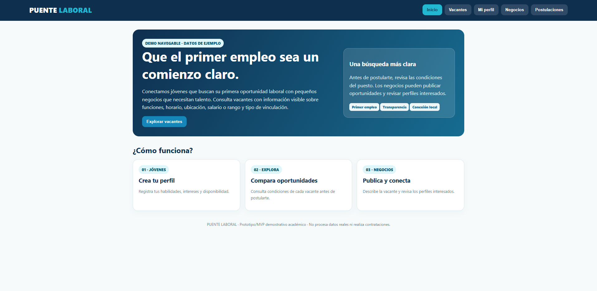
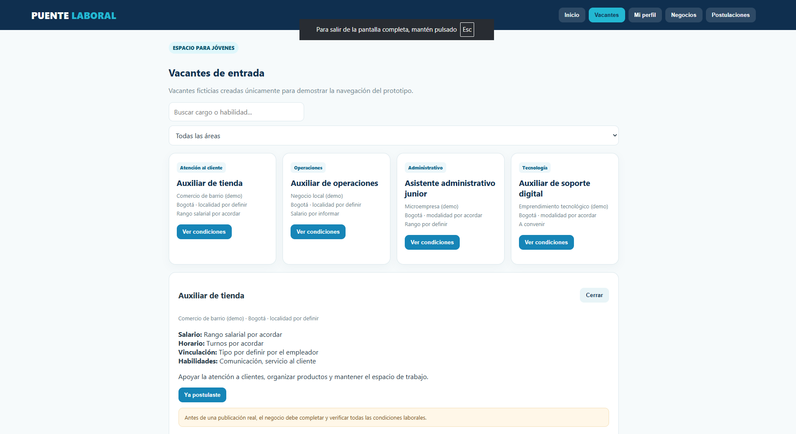
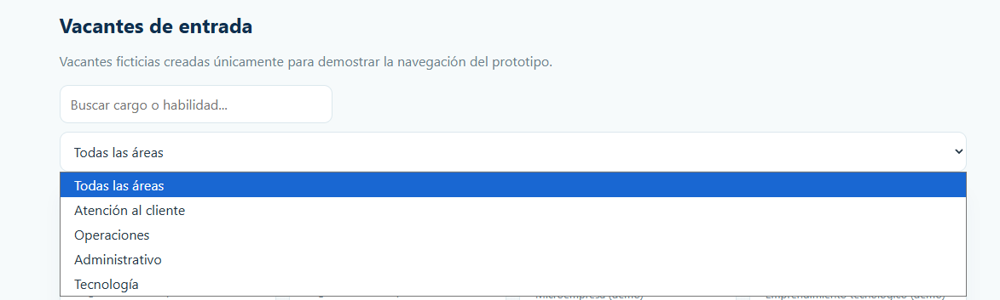
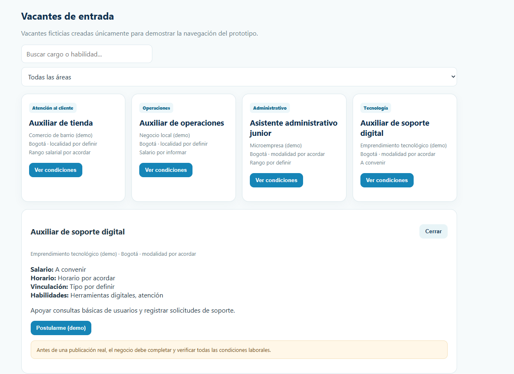
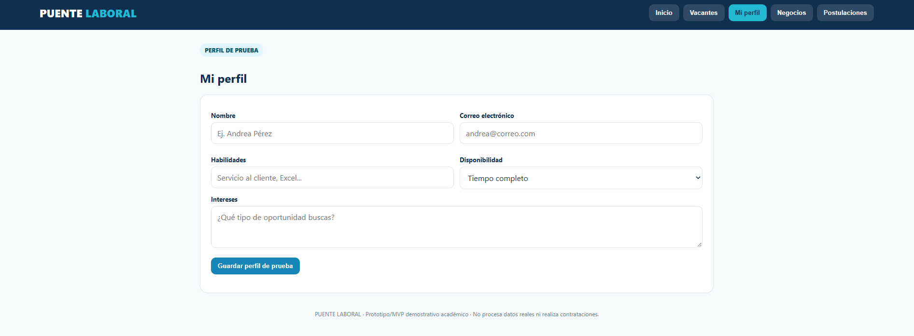
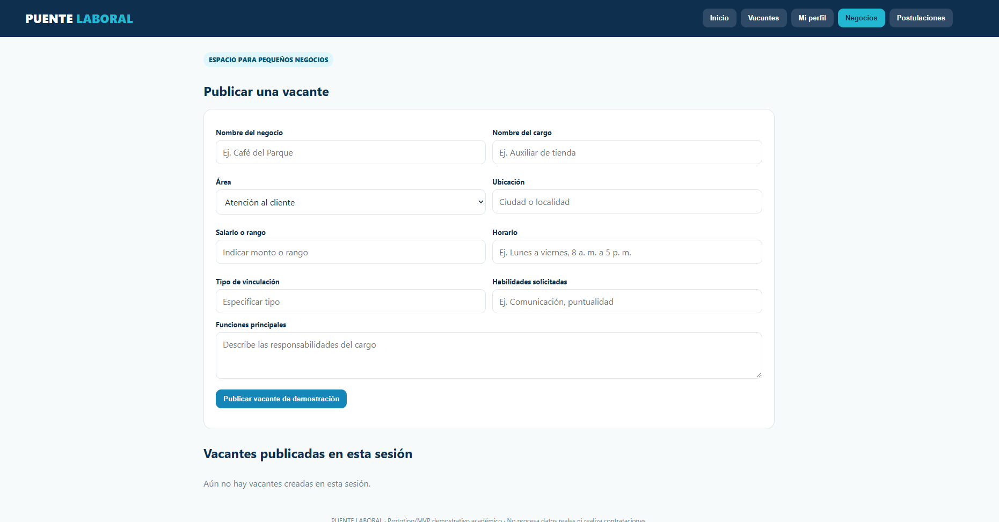
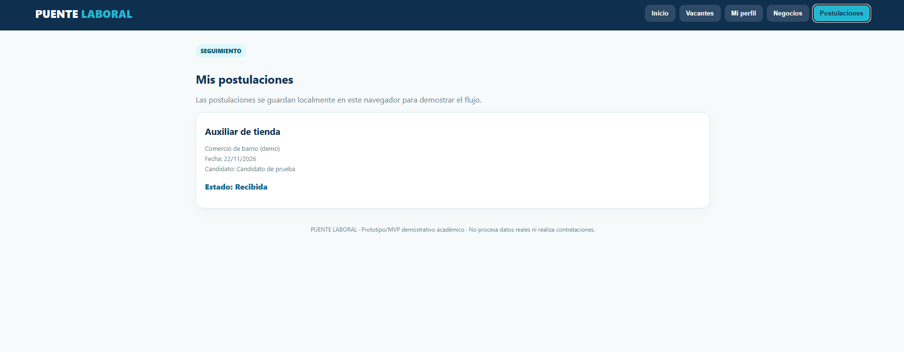

# 🌉 PUENTE LABORAL

### Que el primer empleo sea un comienzo claro.

**Prototipo navegable y Producto Mínimo Viable (MVP) demostrativo**

Conectamos a las personas que buscan oportunidades laborales con empresas y pequeños negocios que necesitan talento.

 

---

## 📌 Acerca del proyecto

**Puente Laboral** es una propuesta de plataforma digital que busca facilitar el encuentro entre dos grupos de usuarios:

- **Personas que buscan empleo:** pueden crear un perfil, explorar oportunidades, consultar las condiciones de cada vacante y hacer seguimiento a sus postulaciones.
- **Empresas y pequeños negocios:** pueden publicar vacantes indicando el cargo, ubicación, salario o rango, horario, tipo de vinculación, habilidades y funciones principales.

La propuesta pone énfasis en la claridad de la información laboral y en hacer más sencillo el proceso de conexión entre candidatos y empleadores.

> Este repositorio contiene un prototipo académico. Las vacantes y los perfiles de ejemplo son datos ficticios y no representan ofertas laborales reales.

---

## 🎯 Objetivo

Desarrollar y demostrar una primera versión de la experiencia de Puente Laboral, permitiendo visualizar cómo interactúan los dos tipos de usuarios dentro de la plataforma.

---

## 👥 Tipos de usuarios

| Usuario | ¿Qué puede hacer? |
|---|---|
| **Personas que buscan empleo** | Crear un perfil de prueba, explorar y filtrar vacantes, revisar sus condiciones, postularse y consultar sus postulaciones. |
| **Empresas y pequeños negocios** | Completar el formulario de publicación y registrar vacantes de demostración para conectar con posibles candidatos. |

---

## ✨ Funcionalidades del prototipo

### Para personas que buscan empleo
- Explorar vacantes de entrada.
- Buscar por cargo o habilidad.
- Filtrar oportunidades por área.
- Consultar detalles de cada vacante.
- Registrar un perfil de prueba con habilidades, intereses y disponibilidad.
- Realizar postulaciones de demostración.
- Consultar el listado y estado de las postulaciones.

### Para empresas
- Acceder al espacio de negocios.
- Completar los datos básicos de una vacante.
- Especificar área, ubicación, salario o rango, horario y tipo de vinculación.
- Describir habilidades solicitadas y funciones principales.
- Publicar vacantes de demostración.

---

## 🖥️ Vistas del prototipo

### 1. Página de inicio

La pantalla principal presenta el propósito de Puente Laboral y explica cómo funciona la conexión entre talento y empresas.

### 2. Exploración de vacantes

Las personas pueden consultar las oportunidades disponibles y revisar información general de cada cargo.

### 3. Filtros de búsqueda

El prototipo permite filtrar las vacantes por área para facilitar la exploración.

### 4. Detalle de una vacante

Cada oportunidad muestra información como salario o rango, horario, tipo de vinculación, habilidades y funciones principales.

### 5. Perfil del candidato

El usuario puede registrar información de prueba, como nombre, correo electrónico, habilidades, disponibilidad e intereses.

### 6. Espacio para empresas

Las empresas pueden diligenciar un formulario para publicar una vacante de demostración con sus condiciones y requisitos.

### 7. Seguimiento de postulaciones

El candidato puede consultar las postulaciones realizadas durante la demostración y visualizar su estado.

---

## 🚀 Cómo ejecutar el prototipo

1. Clona este repositorio o descarga sus archivos.
2. Ubica el archivo principal del prototipo (`Puente_Laboral_Prototipo_MVP.html`).
3. Abre el archivo HTML con un navegador web actualizado, como Google Chrome o Microsoft Edge.
4. Navega por las secciones **Inicio**, **Vacantes**, **Mi perfil**, **Negocios** y **Postulaciones**.

Si el proyecto se publica mediante **GitHub Pages**, configura la página para que apunte al archivo de entrada correspondiente. Si el archivo principal conserva otro nombre o está dentro de una carpeta, ajusta la configuración o ubícalo en la raíz del repositorio.

---

## 🧪 Alcance del MVP demostrativo

Esta versión permite recorrer la interfaz y probar los flujos principales de los dos tipos de usuarios. Algunas acciones se simulan en el navegador y la información de prueba puede almacenarse localmente.

### Limitaciones actuales

- No cuenta con backend ni base de datos central.
- No implementa autenticación real de usuarios.
- No verifica la identidad de las empresas.
- No procesa contrataciones ni garantiza la conexión laboral.
- Las vacantes, perfiles y postulaciones de ejemplo son ficticios.
- No debe utilizarse para publicar ofertas laborales reales ni para recopilar datos personales reales.

Estas capacidades hacen parte de posibles etapas futuras de desarrollo y validación.

---

## 🔭 Próximos pasos

- Validar la propuesta con personas que buscan empleo y empresas.
- Recoger observaciones sobre la navegación y claridad de la información.
- Priorizar mejoras a partir de las pruebas con usuarios.
- Diseñar la arquitectura backend y la base de datos.
- Implementar autenticación y gestión segura de perfiles.
- Incorporar herramientas de administración y seguimiento de procesos.

---

## 🎓 Contexto académico

Proyecto desarrollado como parte de la asignatura **Emprendimiento de Base Tecnológica** del **Politécnico Grancolombiano**.

**Propósito de esta entrega:** presentar la propuesta, demostrar el prototipo/MVP y explicar cómo la solución atiende las necesidades de sus dos tipos de usuarios.

---

**PUENTE LABORAL**  
*Un puente entre quienes buscan una oportunidad y quienes necesitan talento.*

